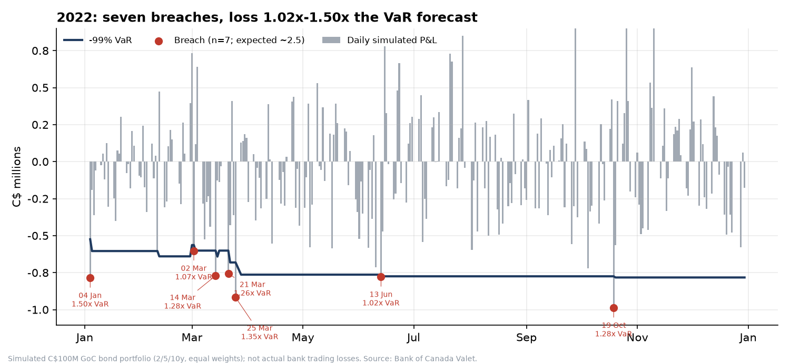
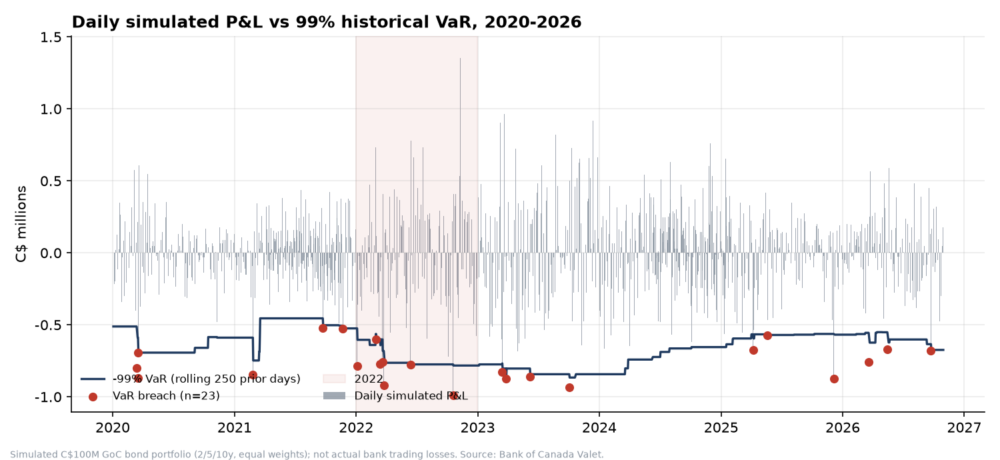
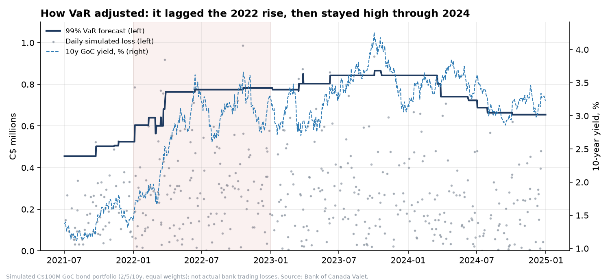
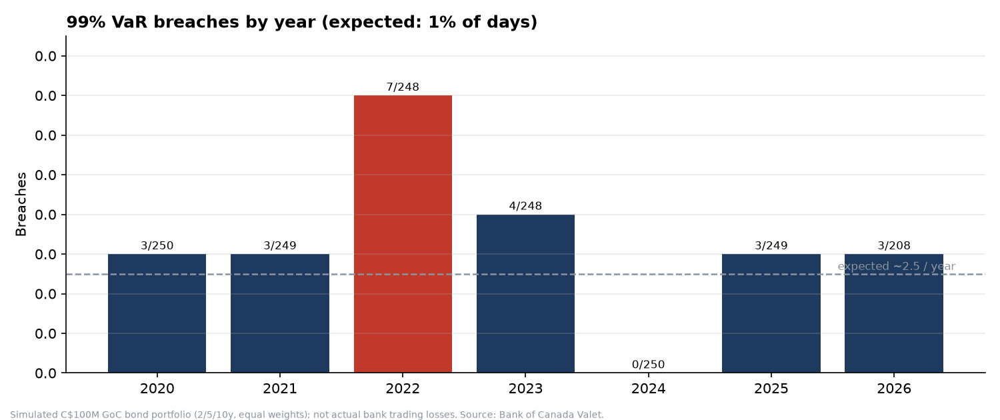
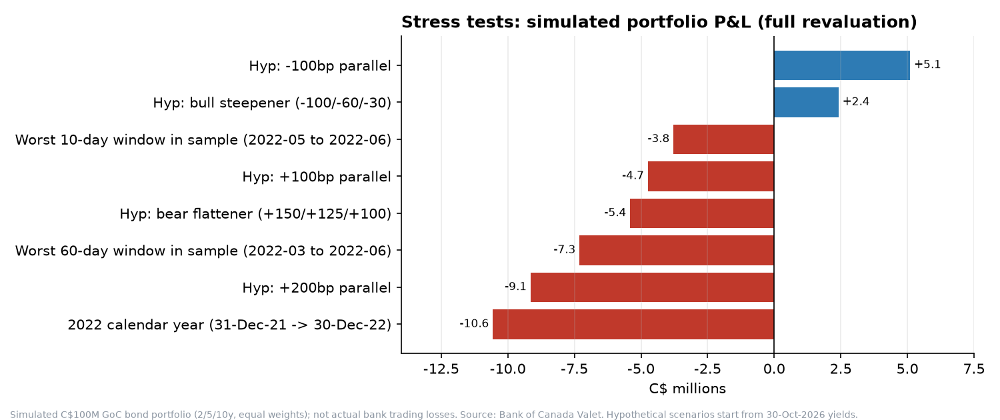
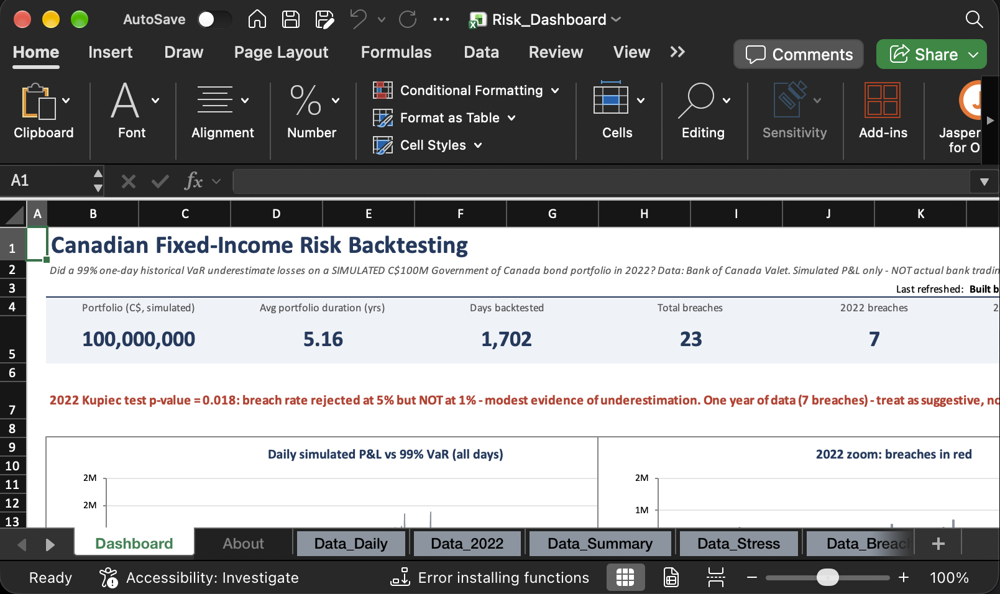

# Canadian Fixed-Income Risk Backtesting

**Research question:** Did a conventional 99% one-day historical Value at Risk (VaR) model underestimate Canadian government bond losses during the 2022 interest-rate tightening cycle?

**Short answer:** modestly yes, with limited statistical strength. On a _simulated_ C$100M Government of Canada bond portfolio, the model was breached on **7 of 248 days (2.8%) in 2022** against the 1% it promises (Kupiec p = 0.018: rejected at 5%, **not** at 1%). In all other tested years combined it was breached 1.10% of the time (16 of 1,454 days, p = 0.71).

> **Simulated vs actual losses.** Every loss in this repository is _simulated_ from public yield changes on a hypothetical portfolio. None of it is, or estimates, any bank's actual trading loss or risk model.



## Results

| Period                         | Days  | Breaches | Expected | Breach rate | Kupiec p | Avg VaR (C$) | Worst simulated loss (C$) | Avg breach loss / VaR |
| ------------------------------ | ----- | -------- | -------- | ----------- | -------- | ------------ | ------------------------- | --------------------- |
| **2022**                       | 248   | **7**    | 2.5      | **2.82%**   | 0.018    | 736,128      | 987,894                   | 1.25x                 |
| Other years (2020-21, 2023-26) | 1,454 | 16       | 14.5     | 1.10%       | 0.705    | 644,480      | 933,408                   | 1.22x                 |
| All tested days                | 1,702 | 23       | 17.0     | 1.35%       | 0.167    | 657,834      | 987,894                   | 1.23x                 |

Per-year breaches: 2020: 3, 2021: 3, **2022: 7**, 2023: 4, 2024: 0, 2025: 3, 2026 (to 30 Oct): 3. Full table: `output/backtest_summary.csv`; all 23 breach dates: `output/breach_list.csv`.

- **Why:** VaR looks backward. The first VaR of 2022 (C$525k, 4 Jan) came from calm 2021 data (daily simulated P&L stdev C$204k vs C$363k in 2022). VaR then rose 49% to C$783k by December; the realised 2022 99th-percentile daily loss (C$783k) ended only 6% above the average 2022 VaR (C$736k). So the miss was largely one of timing. Four of the seven breaches fell between 2 and 25 March 2022.
- **Size of the misses:** breach losses were 1.02x to 1.50x the VaR forecast (average 1.25x). Worst day: C$988k on 19 Oct 2022 vs VaR C$775k.
- **Stress:** replaying the actual 2022 yield moves (2y +311bp, 5y +216bp, 10y +188bp) with full revaluation costs the portfolio C$10.6M (10.6%). Hypothetical +100bp / +200bp parallel shifts from the 30 Oct 2026 curve: -C$4.7M / -C$9.1M.

### How much to trust the 2022 result

- One year, seven events: the Kupiec test has low power. Seven yearly tests were run, so at least one p < 0.05 appears by chance ~30% of the time; 2024 (zero breaches) also rejects, in the _opposite_ direction (p = 0.025, VaR too conservative after the volatile 2022-23 window).
- Christoffersen independence p = 0.56: no formal evidence of clustering.
- Robustness (`output/sensitivity.csv`): a 500-day window still gives 7 breaches in 2022; at 97.5% confidence 2022 breaches 5.6% of days vs 2.5% in other years.

One-page write-up: [`report/Research_Report.pdf`](report/Research_Report.pdf).

|                                                              |                                                          |
| ------------------------------------------------------------ | -------------------------------------------------------- |
|           |  |
|  |      |

## Excel dashboard

`excel/Risk_Dashboard.xlsm` (top of the Dashboard sheet below): KPI tiles, verdict line, P&L vs VaR chart, 2022 zoom, backtest table, 2022 breach list, stress tests and a **Refresh Dashboard** button. Every number is a formula on five Excel Tables (`tblDaily`, `tblY2022`, `tblSummary`, `tblStress`, `tblBreaches2022`), so reloading the tables refreshes everything.



### VBA refresh

`vba/RefreshDashboard.bas` (already embedded in the workbook, behind the button) reloads the five tables from the CSVs in `excel/` using only built-in VBA file I/O: no Shell, no ActiveX, no Windows-only libraries. Tested in Microsoft Excel for Mac.

1. `python src/run_all.py` rewrites the CSVs in `excel/`.
2. Open `excel/Risk_Dashboard.xlsm` and enable macros.
3. Click **Refresh Dashboard** on the Dashboard sheet. On macOS, Excel asks once for permission to read the CSVs: click _Select_/_Allow_. A "Dashboard refreshed" message appears and the _Last refreshed_ cell updates.

The shipped workbook already contains the results quoted in this README. Not tested on Windows. The standalone `.bas` is for review and re-import; the macro-free base workbook can be regenerated with `python src/build_dashboard.py` (writes `excel/Risk_Dashboard_base.xlsx`; Python cannot embed VBA, so add the module and button in Excel if you rebuild).

## Method

| Step      | Detail                                                                                                                                                                                                                                       |
| --------- | -------------------------------------------------------------------------------------------------------------------------------------------------------------------------------------------------------------------------------------------- |
| Data      | Bank of Canada Valet API, GoC benchmark yields `BD.CDN.2YR.DQ.YLD`, `BD.CDN.5YR.DQ.YLD`, `BD.CDN.10YR.DQ.YLD`, business daily, 2 Jan 2019 - 30 Oct 2026 (1,953 days, no nulls or duplicates). Yields are rounded to 0.01% by the Bank.        |
| Storage   | SQLite (`data/yields.db`); reproducible checks and views in `sql/` (data quality, complete-day filter, daily changes with window functions, largest moves, yearly volatility).                                                               |
| Portfolio | C$100M, 1/3 each in 2y, 5y, 10y; exposure reset to equal weights every day (not compounded). Each tranche is a semi-annual par bond (coupon = yield). Portfolio duration 4.8-5.6 years.                                                      |
| P&L       | Per tranche: `-D * dy + 0.5 * C * dy^2`, with modified duration D and convexity C taken from the **previous** day's yield. Price effect only: no coupon carry, roll-down, funding or costs.                                                  |
| VaR       | 99% one-day historical VaR: 1% empirical quantile (linear interpolation) of the **250 P&Ls strictly before** day _t_ (`shift(1)` before the rolling window), so no look-ahead. Breach = loss > VaR. First VaR: 3 Jan 2020 (2019 is warm-up). |
| Tests     | Kupiec (1995) proportion-of-failures; Christoffersen (1998) independence.                                                                                                                                                                    |
| Stress    | Full revaluation of par bonds: hypothetical parallel/twist shifts from the latest curve, and replays of real historical windows (2022 calendar year, worst 10- and 60-day windows).                                                          |

### Validation

`pytest` (9 tests) checks: par bond prices at par; duration/convexity vs closed form and finite differences; duration-convexity P&L within 0.2% of full repricing on a 10bp daily move; VaR vs an independent calculation and **no look-ahead** (changing today's P&L leaves today's VaR unchanged); breach definition; Kupiec closed-form values; yields in the database are sane; and an independent loop-based re-derivation of every VaR and all 23 breaches from `output/daily_results.csv`.

### Limitations

Simulated, price-only P&L on constant-maturity par bonds (no carry, roll-down, credit spread, funding or real positions). Benchmark bonds roll and yields are rounded to 1bp. Only one-day rate risk. 250 observations leave just 2-3 tail points for a 99% quantile, so the VaR estimate itself is noisy.

## Setup and reproducibility

Built and tested with Python 3.15, pandas 3.1 and numpy 2.5 on macOS. Needs internet access for the Bank of Canada API.

```bash
git clone https://github.com/ry504/canadian-bond-risk-backtesting.git
cd canadian-bond-risk-backtesting
python3 -m venv .venv && source .venv/bin/activate
pip install -r requirements.txt
python src/run_all.py        # fetch -> SQLite -> analysis -> charts -> Excel CSVs -> tests -> PDF
```

`run_all.py` re-downloads the latest data. Because the data end date moves, numbers after a new download can differ slightly from those quoted here (data as of 30 Oct 2026; the written report and this README quote that vintage). The PDF step needs Google Chrome (macOS path); otherwise open `report/report.html` and print to PDF. Individual steps: `python src/fetch_data.py`, `python src/run_sql.py` (prints all SQL checks), `python src/run_analysis.py`, `pytest`.

## Project structure

```
src/
  config.py            all assumptions (dates, series, weights, window, confidence)
  fetch_data.py        Valet API -> data/raw_valet_yields.csv + SQLite
  risk.py              duration/convexity, P&L, rolling VaR, Kupiec/Christoffersen, stress
  run_analysis.py      end-to-end analysis -> output/*.csv (+ SQLite result tables)
  run_sql.py           runs every sql/*.sql file
  make_charts.py       output/charts/*.png
  export_excel_csv.py  excel/*.csv (the files the VBA macro loads)
  build_dashboard.py   macro-free base workbook (xlsxwriter; optional)
  run_all.py           reproduce everything
sql/                   data-quality checks and views
tests/                 validation tests
vba/RefreshDashboard.bas   macOS/Windows-safe refresh macro
report/                one-page research report (HTML source + PDF)
data/                  raw API download + SQLite database
output/                results CSVs and charts
excel/                 Risk_Dashboard.xlsm + the CSVs its refresh button loads
```

## Data source

Bank of Canada, _Valet API_ - Government of Canada benchmark bond yields, <https://www.bankofcanada.ca/valet/>. Subject to the Bank of Canada [terms](https://www.bankofcanada.ca/terms/). No other data is used; nothing is estimated or filled in.

## License

MIT, see [LICENSE](LICENSE). Copyright (c) 2026 Ryan Fong.
